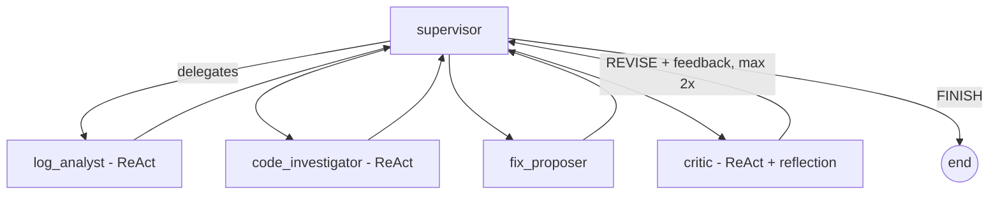

# Agentic Incident Triage

A hierarchical multi-agent system that takes a production incident, finds the failing signal in the logs, locates the code, proposes a fix, and has a reviewer agent check it. Built as a service: HTTP API, budgets and deadlines, prompt-injection defences, persistence with resume, Prometheus metrics, structured logs.

**Agent skills:** supervisor delegation, ReAct, self-reflection, multi-framework-ready state graph (runs on the bundled runtime or on LangGraph), LLM-native metrics (tokens, tokens/sec, TTFT, cost-per-request), granular tracing, state-management optimization with an ablation benchmark.

## Architecture



Full component, lifecycle and data-model diagrams: [docs/ARCHITECTURE.md](docs/ARCHITECTURE.md).

## Quick start

```bash
python -m triage.cli INC-101 --trace out.json     # one incident, offline mock model
python -m triage.benchmark                        # optimization ablation (offline)
python -m pytest                                  # 126 tests
python -m mypy triage                             # type check

python -m triage.server                           # HTTP service on 127.0.0.1:8080
TRIAGE_SERVER_TOKEN=$(openssl rand -hex 24) docker compose up --build   # container (see "Verification")
```

The runtime needs only the Python 3.10+ standard library. The default model is a deterministic **mock** so everything runs offline; use a real model as described below.

## HTTP API

| Method & path | Purpose |
|---|---|
| `POST /v1/triage` | `{"incident": {"id"?, "description"}, "config"?}` -> run result (status, report, metrics) |
| `GET /v1/runs[?limit=&status=]` | recent runs |
| `GET /v1/runs/{id}` | run record with final or partial state |
| `GET /v1/runs/{id}/trace` | full span trace (latest attempt) |
| `POST /v1/runs/{id}/resume` | continue a `failed` / `timeout` / `budget_exceeded` run from its checkpoint |
| `GET /healthz`, `GET /readyz` | liveness, readiness (no auth) |
| `GET /metrics` | Prometheus text format |

```bash
curl -s -X POST localhost:8080/v1/triage \
  -H "Authorization: Bearer $TRIAGE_SERVER_TOKEN" -H "Content-Type: application/json" \
  -d '{"incident":{"id":"INC-101","description":"Checkout returns HTTP 500 printing a label. NullPointerException in the order service."}}'
```
The bundled sample logs know incidents `INC-101`..`INC-110`; for your own data, plug in your sources (below).

## Production features

| Area | What it does | Details |
|---|---|---|
| Failure handling | Model/tool/budget/timeout problems end in a recorded status with the partial result; nothing escapes as an exception | [ARCHITECTURE](docs/ARCHITECTURE.md#run-lifecycle) |
| Guardrails | Per-run caps on LLM calls, tokens, cost and wall-clock time; step and revision limits | `guardrails.py`, `settings.py` |
| Resume | Runs checkpoint to SQLite after every step; failed runs continue where they stopped | `store.py`, `pipeline.resume_incident` |
| Security | Read-only allow-listed tools, validated arguments, sandboxed code root, prompt-injection scrubbing, bearer auth, input and size limits, secret redaction | [SECURITY](docs/SECURITY.md) |
| Observability | Trace per run (tokens, TTFT, cost, latency, errors), Prometheus metrics, JSON logs | [RUNBOOK](docs/RUNBOOK.md) |
| Operations | Health/readiness probes, graceful drain on SIGTERM, concurrency cap with `429`, 12-factor config with startup validation | [RUNBOOK](docs/RUNBOOK.md) |
| Delivery | `pyproject.toml`, Dockerfile (non-root, read-only), compose, Makefile, CI | `.github/workflows/ci.yml` |

## Optimization benchmark

Each row turns on one optimization; `optimized` combines all four. Averages over 10 sample incidents.

| config | tokens in | cost/request | vs baseline | tok/s | TTFT (s) | latency (s) | cache hits | resolved |
|---|---:|---:|---:|---:|---:|---:|---:|---:|
| baseline | 4530 | $0.01676 | +0% | 22 | 0.45 | 9.93 | 0.0 | 100% |
| compact_state | 1704 | $0.00828 | -51% | 22 | 0.45 | 9.93 | 0.0 | 100% |
| model_routing | 4530 | $0.00332 | -80% | 48 | 0.18 | 4.75 | 0.0 | 100% |
| tool_scoping_cache | 3626 | $0.01405 | -16% | 22 | 0.45 | 9.81 | 1.5 | 100% |
| **optimized** | **1602** | **$0.00183** | **-89%** | 48 | 0.18 | 4.63 | 1.5 | 100% |

1. **compact_state:** hand structured findings to the next agent instead of the full ReAct transcript.
2. **model_routing:** cheap model for routing, extraction and review; strong model only for the fix.
3. **tool_scoping:** log search scoped to the incident, windowed file reads, capped observations.
4. **cache:** identical tool calls within a request are memoized.

**Read these numbers honestly.** The model is a deterministic mock. Token counts come from real prompt sizes (approximate tokenizer), so the state-handoff savings are real mechanics, but **latency, TTFT and tokens/sec are simulated** and **prices are placeholders** (`observability.PRICING`). "Resolved 100%" shows the plumbing works on a small synthetic set; it says nothing about real-model accuracy. Re-run with a real model before quoting cost or latency.

## Using a real model

`triage/providers.py` is a dependency-free streaming client for the Anthropic Messages API and any OpenAI-compatible endpoint (OpenAI, Gemini's compatible endpoint, Groq, Ollama, vLLM). TTFT is measured at the first streamed token; token counts come from provider usage fields. Model names and prices are required so nothing stale is hard-coded:

```bash
export TRIAGE_PROVIDER=anthropic                 # or openai
export ANTHROPIC_API_KEY=...                     # or OPENAI_API_KEY / TRIAGE_API_KEY
export TRIAGE_MODEL_SMALL=<cheap model id>       # supervisor, log analyst, investigator, critic
export TRIAGE_MODEL_LARGE=<strong model id>      # fix proposer (and everything in the baseline)
export TRIAGE_PRICE_SMALL="0.25,1.25"            # USD per 1M tokens: input,output (your provider's real prices)
export TRIAGE_PRICE_LARGE="3,15"
# local/free: TRIAGE_PROVIDER=openai TRIAGE_BASE_URL=http://localhost:11434/v1  (Ollama)

python -m triage.cli INC-101 --llm env           # one run
python -m triage.benchmark --llm env --limit 3   # cheap smoke run; writes results/benchmark_real.md
TRIAGE_LLM=env python -m triage.server           # service backed by the real model
```
Start with one incident: the client path is tested against a local fake server only (see Verification).

## Plugging in your own logs and code

Implement two small interfaces (`tools.LogSource.search`, `tools.CodeSource.resolve/grep/read`) for Loki, Elasticsearch, a Git checkout, etc., and pass them to `run_incident(..., logs=..., code=...)`. Tool arguments are validated and all returned text is scrubbed and marked untrusted regardless of the source.

## Verification status

| Verified in the build environment | Not verified (needs you) |
|---|---|
| 126 tests pass on Python 3.13, repeated runs stable | Any live LLM provider (client tested against a local fake server over real HTTP/SSE) |
| `mypy` clean on the package (targeting 3.10 typing) | The real LangGraph port (`langgraph_port.py`: LangGraph could not be installed) |
| Live server smoke test with `curl`: auth, validation, triage run, metrics, SIGTERM shutdown; in-flight drain covered by a test | `docker build`, `docker compose up`, and the CI workflow (no Docker daemon here) |
| Offline benchmark | Runtime on Python 3.10-3.12 (only 3.13 available) |
| | Behaviour under real load, a real Prometheus scrape, a security review |

## Layout

```
triage/            agents, graph runtime, tools, llm (mock) + providers (real), pipeline, store, metrics,
                   guardrails, settings, server, cli, benchmark, langgraph_port
sample_data/       10 incidents, generated logs, small Java app, generate.py
tests/             126 tests: graph, tracing, routing, reflection, guardrails, failures/resume, store, metrics,
                   settings, HTTP server (auth, limits, concurrency, drain), real-client path via fake server
docs/              ARCHITECTURE, SECURITY, RUNBOOK, discovery (template), RESUME_AND_DEMO
results/           benchmark.md/json (mock) and baseline vs optimized traces
```

## Known limitations

- Technical discovery ([docs/discovery.md](docs/discovery.md)) is a template; the answers must come from a real stakeholder conversation.
- Single-node design (SQLite, in-process concurrency cap). See the capacity notes in the runbook for scaling.
- Sanitization is heuristic; the structural defences matter most ([SECURITY](docs/SECURITY.md#residual-risks-read-these)).
- No TLS or per-user auth in the process: front it with a TLS proxy.
