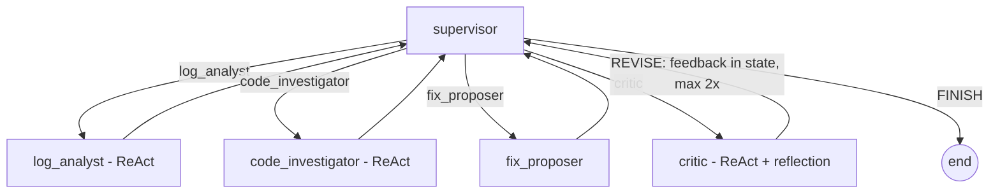
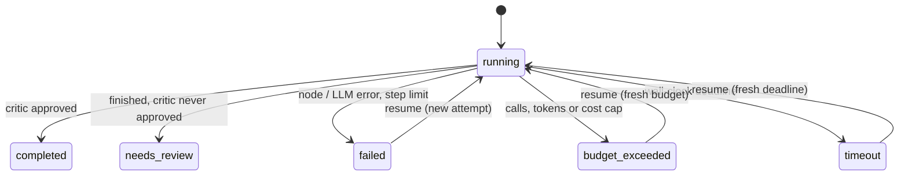

# Architecture

## Components

```mermaid
flowchart LR
    client([client / on-call tooling]) -->|HTTP + bearer token| server
    subgraph service[triage service - one process]
        server[server.py<br/>auth, validation, limits] --> pipeline[pipeline.py<br/>budget, deadline, statuses]
        pipeline --> graph[graph.py<br/>state-graph runtime]
        graph --> agents[agents.py<br/>supervisor + 4 workers]
        agents --> llm[(LLM client<br/>mock or providers.py)]
        agents --> tools[tools.py<br/>validated, read-only]
        tools --> logs[(LogSource)]
        tools --> code[(CodeSource)]
        pipeline --> store[(SQLite<br/>runs, checkpoints, traces)]
        pipeline --> metrics[metrics.py<br/>Prometheus text]
    end
    prom([Prometheus]) -->|scrape /metrics| server
```

## Agent graph (one incident)



Every worker returns to the supervisor, so the supervisor is the single place where routing is decided
and validated (`agents.next_from_flags` repairs invalid or premature choices). It is also why a run can
be resumed by re-entering at the supervisor with the last checkpointed state.

## Run lifecycle



`run_incident` never raises for these cases; it returns the status plus the partial state, so a
caller (or the HTTP layer) always has something to report and persist.

## Data model (SQLite)

| table | key | purpose |
|---|---|---|
| `runs` | `id` | one row per run: status, attempts, cumulative cost/tokens, final or partial state |
| `checkpoints` | `(run_id, attempt, step)` | state after every graph step; the last one is the resume point |
| `traces` | `(run_id, attempt)` | full span tree + summary per attempt |

## Observability

- **Traces:** one tree per attempt: `incident` -> agent spans -> `llm` / `tool` spans, with tokens in/out,
  TTFT, latency, cost, cache hits, injection flags, and `status`/`error`. Ids (`trace_id`, `span_id`,
  `parent_id`) match OpenTelemetry's model, so an OTLP exporter is a small addition.
- **Metrics:** Prometheus text at `/metrics` (runs by status, tokens, cost, tool outcomes, latency and cost
  histograms, in-flight gauge, HTTP requests by low-cardinality route).
- **Logs:** one JSON object per line to stderr (`run_started`, `run_finished`, `http_request`,
  `injection_suspected`, ...). No prompts, completions or credentials are logged.

## Design decisions

1. **Standard library only at runtime.** Fewer moving parts to audit and install; the HTTP layer is small
   enough that a framework adds more surface than it removes. Trade-off: no async, so concurrency is
   threads (capped by `TRIAGE_MAX_CONCURRENT`).
2. **State graph with LangGraph's contract.** Nodes are `state -> update` functions with Annotated
   reducers, so the same nodes run on `graph.py` or on LangGraph (`langgraph_port.py`).
3. **Never trust the model's control flow.** Routing is validated, ReAct output after an `Action:` is
   discarded, tool names are allow-listed and arguments validated, loops are bounded by step, call,
   token, cost and time limits.
4. **Synchronous request model.** A triage request holds its connection for the run's duration (bounded by
   `TRIAGE_RUN_TIMEOUT_S`); excess load gets `429 Retry-After`. For long runs or many callers, move
   `run_incident` behind a job queue; the store, resume and status model already support that.
5. **SQLite.** Zero-ops and transactional; fine for a single node. For multiple replicas, swap `Store`
   for Postgres (the interface is a dozen methods).
6. **Pluggable data sources.** `LogSource` / `CodeSource` are two tiny interfaces, so pointing the agents
   at Loki, Elasticsearch or a Git checkout does not touch agent code.
